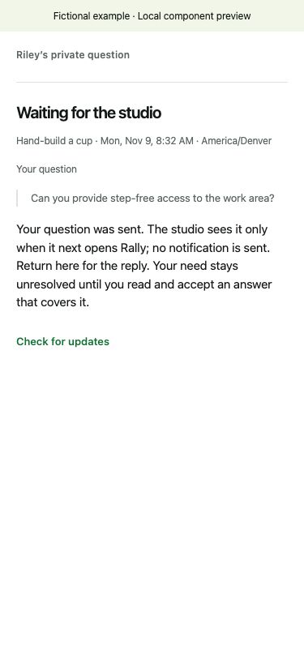
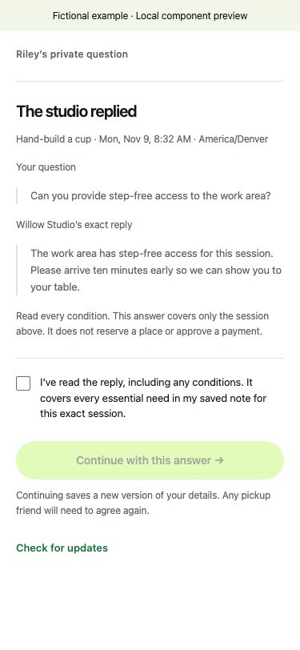

# Book together. Pay your own share.

Rally helps friends find a studio session that works for everyone and book it
without one person covering the group’s bill. Saved dates, spending limits and
must-haves are checked privately. **PayPal** handles each friend's own sandbox
payment. Optional **AI**, powered by Claude Sonnet 4.6 through Astropods, clarifies
messages and helps phrase studio questions. People review the proposals and
explicitly approve each commitment.

[Try the prepared group](https://rally.gowthamsarveswaran.com/demo) ·
[Watch the 2:45 demo](https://youtu.be/7RRgzfhbguA) ·
[Guides](https://rally.gowthamsarveswaran.com/docs) ·
[Developer setup](docs/development.md) ·
[Verification](evidence/README.md)

*Recorded PayPal sandbox booking, 3 October 2026 · earlier interface. The linked
2:45 video combines a 1 November sandbox booking with a separate 4 November
studio-question example.*

## A shared plan without a shared wallet

A session can fit the group only if the dates, price, activity and pickup
arrangements work together. Rally checks the confirmed private choices before
the studio makes an offer. Each friend then pays their own share; the organizer
does not need to front the group’s bill.

## How it works

1. **Bring your friends.** Start a plan and share its invite in your group chat.
2. **Find a session that fits.** Everyone adds their availability, private
   spending limit and requirements. Rally checks the studio's published options.
3. **Agree on pickup.** If someone needs a friend to pick up their piece after
   firing, both people explicitly agree to the arrangement.
4. **Get the studio's offer.** The studio reviews the session, roster, price and
   terms, reserves the time and opens a two-hour approval window.
5. **Approve your own share.** PayPal authorizes each person's payment. Rally
   starts collecting after all required authorizations qualify and confirms
   the booking after every payment completes.

Each person's next step appears at the top of their plan. A private conflict,
like a required $72 wheel session above a $60 spending limit, is explained to
that person. Shared readiness does not disclose private answers or guarantee
that a session fits the whole group. If an accepted studio answer restricts a
friend to a session that no longer fits, only its owner sees that explanation;
peers receive a generic no-fit message and can still appear ready.

## AI helps clarify what a friend means

An optional AI draft can turn a message into activity and pickup choices, or
ask one question when the meaning matters. “I leave Friday” could mean someone
cannot attend, or that they need help picking up their fired piece. The person
reviews the proposed meaning before saving it; a pickup friend must still agree.

Rally uses Claude Sonnet 4.6 through Astropods for model inference. The AI receives
the consenting person's submitted message and public studio facts. It cannot choose a spending limit,
volunteer another friend, reserve a session or approve a payment. The form
remains available throughout. [AI behavior and evaluation](docs/ai-evaluation.md).

For an essential need the form cannot cover, a friend can privately ask the
studio about a specific session. The friend writes a question, reviews exactly
what it shares and explicitly consents to send it. Optional AI help drafts a
question from a quoted need. Rally applies the same checks for known names,
contact details and financial wording to both manual and AI-drafted questions;
these checks do not guarantee anonymity. The friend reviews what to share. The
studio replies in its own words, and the friend reviews any conditions before
continuing. Answers apply only to that exact session. AI does not verify studio
capabilities or decide whether an answer is sufficient.
[Private studio questions](docs/studio-questions.md).

<table>
  <tr><th>Ask about an essential need</th><th>Review the studio’s exact reply</th></tr>
  <tr>
    <td valign="top"></td>
    <td valign="top"></td>
  </tr>
</table>

*Current studio-question components in a local fictional example, 4 November
2026. These screenshots use simulated identity and a seeded studio reply; they
are not a hosted user trial or an AI inference result.
[Image provenance](docs/images/README.md).*

## Separate payments, one booking decision

Each payment goes to the studio's PayPal merchant account: a single configured
sandbox merchant in this demo. The organizer does not collect a pooled balance.
These are separate transactions. If settlement fails partway through, Rally
starts refunds for completed charges and releases remaining holds. Uncertain
outcomes stay visible until verified; they do not count as a confirmed booking.

[Payment and privacy details](docs/payments-and-privacy.md) explain approvals,
pickup visibility, withdrawals and recovery.

## Implementation

PayPal's **Orders API v2** creates each friend's checkout with `AUTHORIZE` intent.
The **Payments API v2** supplies captures, refunds, voids and resource checks.
Signed **PayPal Webhooks** support reconciliation; a browser return alone never
establishes payment success.

The web application uses **Next.js, React and TypeScript**, with **PostgreSQL and
Supabase Auth**, and runs on **Render**. Optional AI inference runs in a separate
authenticated **Astropods** worker. The worker has no database or PayPal credentials.

| Source | Responsibility |
| --- | --- |
| [`app/`](app/) | Friend, organizer and studio screens, server routes and public guides. |
| [`src/intake/`](src/intake/) and [`src/planning/`](src/planning/) | Private choices, consent, matching and each person's next step. |
| [`src/bookings/`](src/bookings/) and [`src/payments/`](src/payments/) | Exact offers, durable payment operations, verification and recovery. |
| [`src/ai/`](src/ai/) and [`deploy/ai-worker/`](deploy/ai-worker/) | AI prompts, validation, authenticated worker, Dockerfile and Astropods blueprint. |
| [`db/`](db/) and [`src/migrations.ts`](src/migrations.ts) | The complete ordered database migrations. |
| [`test/`](test/) and [`fixtures/`](fixtures/) | Automated checks, controlled providers and fictional evaluation cases. |

All application and worker source, assets, migrations and lockfiles are included.
Generated bundles are rebuilt with `npm run build` and `npm run ai:build`.
Credentials and prepared account checkpoints stay outside source control.

## Recorded evidence

| What you can check | Recorded result and scope |
| --- | --- |
| [Latest release checks](evidence/studio-question-recovery-2026-11-04.json) | 274 passing tests, 93/93 caught mutation guards, typecheck and both builds; local PostgreSQL and controlled providers, 4 November. |
| [Separate PayPal payments](evidence/web/hosted-six-friend-settlement.json) | Six distinct sandbox buyers, six $48 captures and $288 gross; hosted run, 3 October. |
| [Studio-question AI evaluation](evidence/studio-question-evaluation-1793761616523.json) | Corrective six-case authored regression run; earlier failures retained, 3 November. Not a general reliability rate. |
| [Failure recovery](evidence/paypal-sandbox/index.html) | Separate local-service runs with real sandbox buyers covered partial-failure refunds, remaining voids and lost-response recovery. Hosted active failure recovery remains unverified. |

The [verification index](evidence/README.md) links the evidence and its limits.
Independent friend-group use and real studio demand have not been measured.

## Try it or run it locally

The [hosted app](https://rally.gowthamsarveswaran.com) uses email-link sign-in.
The current release is a **PayPal sandbox application with a fictional pottery
studio**; it does not sell real sessions or take live payments. Its Free host
can take about a minute to wake.

The [judge entry](https://rally.gowthamsarveswaran.com/demo) also provides a
recorded journey without an account, plus isolated live planning with a privately
supplied access code. [Prepared test access](docs/test-access.md) explains the
fictional setup and separate sandbox checkout requirements.

- Install **Node.js 22 or later**, **PostgreSQL 17** and **OpenSSL**. Run `npm ci`
  from the repository root, then follow the linked setup for the path you need.
- [Use Rally](docs/product-guide.md): invitations, private choices, studio offers
  and payment status.
- [Run the automated checks](docs/development.md#test-without-external-accounts):
  local PostgreSQL and controlled providers; no external accounts required.
- [Run the application](docs/development.md#run-the-app): Supabase Auth,
  sandbox PayPal and optional AI configuration.
- [Build the AI worker](docs/ai-worker.md): source bundle, local checks and
  the Astropods gateway and service-token configuration.
- [Inspect recorded results](evidence/README.md): hosted sandbox settlement,
  recovery checks, model evaluations and current verification limits.

See the [architecture](docs/architecture.md) and
[operations guide](docs/deployment.md) for service boundaries and deployment.

Licensed under [MIT](LICENSE).
