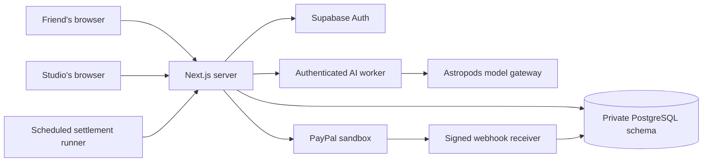

# Architecture

Rally separates private planning, optional interpretation, studio approval and
financial settlement. Human commands create commitments; model output supplies
only proposals. PostgreSQL keeps the state required to survive retries and
process restarts.

## Browser and identity

React screens display role-specific projections from server APIs. Supabase Auth
verifies email identity. The server binds each command to the authenticated
actor, object and workspace; caller-supplied identities do not establish access.
Origin checks, bounded request bodies, quotas and private response caching rules
apply at the HTTP boundary.

The main surfaces are `/plans`, `/groups/[id]`, `/offers/[id]` and `/studio`.
`/demo` uses separate, prepared fictional identities and isolated workspaces.
It is not a substitute for testing normal invitation and email sign-in.

## Planning and explicit consent

`src/intake/` owns membership, immutable preference revisions, pickup consent,
attendance decisions and private projections. `src/planning/` checks confirmed
requirements against the published catalog. Its filters include activity, price,
availability, end time, group size and collection rules.

The planner uses confirmed inputs, whether they originated in the form or an AI
proposal. It never relaxes a requirement to manufacture a match. Private conflicts
are explained to their owner; shared projections contain names, readiness and
public session facts rather than private answers.

`next-step.ts` selects the current action for both plan cards and the plan list.
It does not decide whether money moved. Saved details, an unresolved need and a
completed participation decision remain distinct facts.

Pickup consent binds both people to a specific preference revision. Attendance
opt-outs persist across subsequent offers until the same member returns. The
studio-contact marker records a participant assertion and explicit notice
consent; it is not a verified merchant capability.

## Bounded AI inference

`src/intake/message-drafts.ts` persists optional work before dispatch, checks
ownership and quotas, and fences stale results. The interpreter returns a closed
schema with grounded text spans and at most one question. The person must review
and save the choices.

The production worker has a dedicated bearer token and no database or PayPal
credentials. It cannot write preferences, nominate a collector or authorize any
transaction. Render keeps the authoritative state and calls the worker over
HTTPS. [AI behavior and evaluation](ai-evaluation.md).

## Studio approval freezes an offer

`src/bookings/` checks the confirmed plan against the immutable published catalog.
The studio operator confirms delivery, calendar blocking, pickup arrangements
and automatic settlement. Approval reserves the buffered resource interval and
freezes the roster, session, price and terms in an offer snapshot.

The server verifies the complete snapshot's hash before projecting it. A friend
receives only pickup arrangements involving them; the studio retains the full
arrangement view. Financial acceptance binds to the original server snapshot,
not a client-authored price or roster.

## Durable payment processing

`src/payments/` owns per-person orders, authorizations, captures, refunds, voids
and provider reconciliation. Stable operation identities, request fingerprints,
transaction locks and dispatch leases protect retries and late responses.
The adapter targets PayPal sandbox and verifies expected payer, amount, currency
and resource relationships.

Settlement starts after every required authorization qualifies. Confirmation
requires every required capture to be verified. Because payments are separate,
partial failures need compensation, not a claim of atomic settlement. Unknown
provider outcomes remain unresolved until checked.

Webhooks authenticate the original bytes, deduplicate receipts and attach
provider resource references to existing operations. They cannot independently
mark a payment or booking successful. Provider checks remain authoritative.
[Webhook receiver](paypal-webhooks.md).

## Data and execution

Supabase hosts Auth and the private PostgreSQL schema. The application uses a
restricted database role with certificate-verified TLS. Additive SQL migrations
are listed in `src/migrations.ts`; the current schema includes migration 016.
Private raw text has bounded retention while confirmed choices and financial
history remain available for reconciliation.

The existing Render Free service runs the web application. Supabase Cron invokes
authenticated, bounded settlement processing while work exists. A separate SQL
job handles private-text maintenance without keeping the web service awake.
Local development runs the same payment engine through `npm run worker`.
[Deployment](deployment.md) · [Database](hosted-database.md) ·
[Retention](private-text-retention.md).
